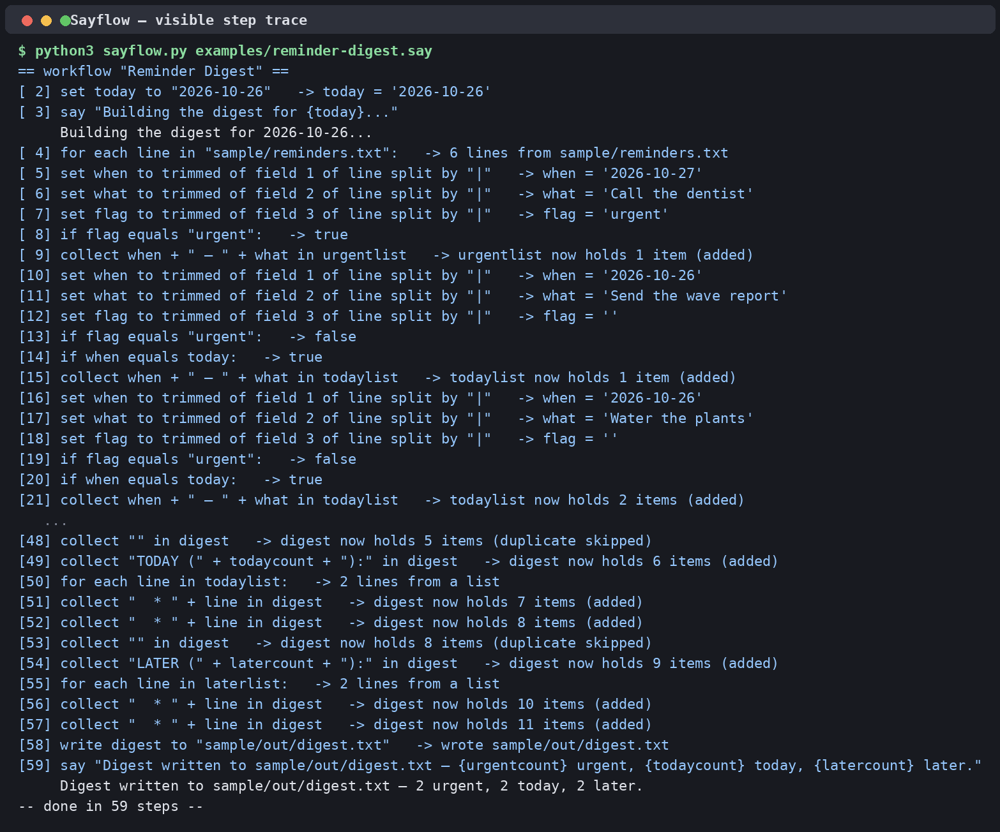

# Sayflow

**Write agent workflows the way you'd say them.**

Sayflow is a small programming language for people who do not program. You write an automation as near-English lines —

```sayflow
workflow "File Triage"

for each file in "sample/inbox":
  if filename contains "invoice":
    move file to "sample/sorted/invoices"
  otherwise:
    move file to "sample/sorted/other"
  end
end

say "Done."
```

— and Sayflow compiles those lines into an executable workflow and runs it with a **visible step trace**: every decision, every file moved, every value set is printed as it happens. Nothing is hidden inside the machine. If a non-programmer can say what they want an agent to do, they can read a Sayflow program — and audit exactly what it did.



## Why a language you can say out loud?

Agent automations are usually written in Python, YAML, or a drag-and-drop builder — all of which shut out the people who actually know the workflow: the office manager, the nurse, the shop owner. Sayflow's design philosophy:

1. **Sentences, not syntax.** One idea per line, keywords are ordinary English words, punctuation is just a colon to open a block and the word `end` to close it.
2. **The trace is the interface.** Running a workflow narrates itself step by step, so the author can follow, trust, and debug it without reading code.
3. **Safe by default.** A Sayflow program can only touch files inside its workspace folder. A path that tries to escape is refused, in plain language.
4. **Errors that teach.** Mistakes are reported with the line number, the line itself, and a hint — never a stack trace.

## Quick start

Needs Python 3.9+ and nothing else (standard library only).

```bash
# run the examples (they operate on the bundled sample data)
python3 sayflow.py examples/reminder-digest.say
python3 sayflow.py examples/data-cleanup.say
python3 sayflow.py examples/file-triage.say

# restore the sample data afterwards (triage moves files)
python3 reset_samples.py

# check a program without running it, or run the built-in test suite
python3 sayflow.py --check examples/file-triage.say
python3 sayflow.py --selftest
```

## The three example workflows

| Program | What it does |
|---|---|
| `examples/file-triage.say` | Sorts a messy inbox folder: invoices by name, notes and data by file type, everything else to a catch-all folder. |
| `examples/reminder-digest.say` | Reads a plain-text reminder list (`date \| task \| flag`) and writes a grouped digest: urgent first, then today's, then later. |
| `examples/data-cleanup.say` | Cleans a ragged CSV export — trims spacing, normalises case, drops the header and empty rows, and removes duplicates — and writes one tidy list. |

## Language reference

A Sayflow program is a list of lines. Blank lines are ignored. Anything after a `#` is a comment. Blocks opened by a line ending in `:` are closed by a line that says `end`.

### Starting and speaking

| Line | Meaning |
|---|---|
| `workflow "Name"` | Optional first line; names the workflow (shown in the trace). |
| `say <value>` | Print something. `{name}` inside a quoted sentence is replaced by that value. |
| `stop` | End the workflow early. |

### Values

| Line | Meaning |
|---|---|
| `set <name> to <value>` | Remember a value under a name. |
| `read "<file>" into <name>` | Load a whole text file into a name. |
| `collect <value> in <name>` | Add to a list. A value already in the list is skipped — collecting is how you deduplicate. |
| `count files in "<folder>" into <name>` | Count the files directly inside a folder. |
| `length of <value>` | How many items in a list, or characters in a text. |

Values can be joined with `+` (or the word `plus`): numbers add, everything else is joined as text.

### Doing things to files

| Line | Meaning |
|---|---|
| `move <file> to "<folder>"` | Move a file into a folder (created if needed; the file keeps its name). |
| `copy <file> to "<folder>"` | Copy a file into a folder. |
| `delete "<file>"` | Delete a file. |
| `make folder "<path>"` | Create a folder (and any missing parents). |
| `write <value> to "<file>"` | Write a value to a file, replacing it. Lists are written one item per line. |
| `append <value> to "<file>"` | Add a value to the end of a file. |

All paths are relative to the workspace (the folder you run Sayflow from, or `--root`). Paths that climb out of the workspace are refused.

### Repeating

```sayflow
for each file in "<folder>":
  ...
end
```

Inside the block, three names are set for you: `file` (the file's path), `filename` (just its name), and `extension` (its type, lower-case, no dot).

```sayflow
for each line in "<file>":
  ...
end
```

Here `line` is the current line and `linenumber` its number, starting at 1. You can also loop over a list or a text value you set earlier (`for each line in mylist:`).

### Choosing

```sayflow
if <condition>:
  ...
otherwise:
  ...
end
```

Conditions, all in words:

- `<value> contains "text"`, `starts with`, `ends with`, `equals`
- `<value> is empty`, `is not empty`
- `<number> is more than <number>`, `is less than`, `is at least`

`if` blocks nest as deeply as you need.

### Shaping text (transforms)

Transforms are little phrases placed before a value, and they chain:

- `lowercase of <value>`, `uppercase of <value>`, `capitalised of <value>`, `trimmed of <value>`, `length of <value>`
- `field <n> of <value> split by "<sep>"` — pick the n-th piece of a text split on a separator: `field 2 of line split by ","` is the second column of a CSV row.

Example, all in one line:

```sayflow
set row to capitalised of name + " | " + lowercase of trimmed of field 2 of line split by ","
```

### Grammar, formally

```
program     := statement*
statement   := workflow | say | set | read | collect | count
             | for_each | if | move | copy | delete | make_folder
             | write | append | stop
for_each    := "for each" ("file" | "line") "in" expr ":" block "end"
if          := "if" condition ":" block ["otherwise" ":" block] "end"
condition   := expr ("contains" | "equals" | "starts with" | "ends with") expr
             | expr "is" ("empty" | "not empty" | "more than" expr
             |             "less than" expr | "at least" expr | expr)
expr        := unary (("+" | "plus") unary)*
unary       := transform | field_pick | term
transform   := ("lowercase" | "uppercase" | "capitalised" | "trimmed"
             |  "length") "of" unary
field_pick  := "field" number "of" unary "split by" string
term        := string | number | name | "(" expr ")"
```

## How it's built

- **Lexer** — splits each line into words, quoted strings, and numbers; strips `#` comments without touching `#` inside quotes.
- **Parser** — recursive descent. Expressions bind the way English reads (a transform applies to the single value right after `of`, not the whole sentence — this was caught and fixed during testing when a title-cased name tried to title-case an entire row). Blocks are parsed recursively, so `if`/`for` nest naturally.
- **Interpreter** — walks the parsed program with an environment of named values, executing file actions inside the sandboxed workspace and printing the step trace as it goes.
- **Self-test** — `python3 sayflow.py --selftest` runs all three examples in a throwaway folder and checks the results a user would see (files actually sorted, digest actually grouped, duplicates actually gone), plus the friendly-error and sandbox-escape behaviour: 8 checks, all passing.

## Roadmap ideas

- `ask` — pause and let a human approve the next step (an approval gate, in English).
- `send` / `fetch` steps for email and web sources, behind the same trace.
- A read-aloud mode: the trace as speech, for accessibility.
- More transforms (`words in`, `reversed`) and a `while` loop with a plain-English guard.

## Build Disclosure

Build Disclosure: AI-built. Built by AI agents (Tree / Muse fleet) directed by Rene Turcios during the hackathon period; Rene set the direction and reviewed; agents designed, coded, and tested.

## License

MIT — see [LICENSE](LICENSE).
